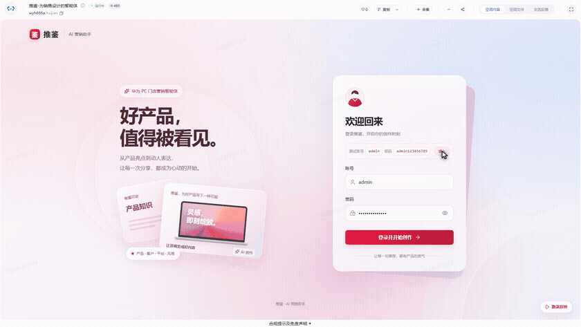

<div align="center">

# 演录 · web-demo-video

**Turn any web demo into a 1080p video people will actually watch**

Real cursor movement · real clicks · deterministic frames · optional soundtrack

[](CHANGELOG.md)
[](LICENSE)
[](package.json)
[](#requirements)
[](https://github.com/LiliLIN0324/web-demo-video-skill/stargazers)

[Quick start](#quick-start) · [How it works](#how-it-works) · [中文](README.md)

<a href="assets/cover.mp4"></a>

<sub>Click to watch the full 42-second cut with synthesized music. Demo site: 推鉴 · AI Marketing Assistant (ModelScope Studio).</sub>

</div>

---

## Why

Recording a web demo usually goes wrong in three places:

1. **Screen recorders drop frames** on slow pages — the cursor stutters and floats.
2. **Loading screens end up in the cut** — a second of white skeleton right after every click.
3. **There is no sound**, or the click SFX lands late.

This skill takes a different route: **frame capture, not screen recording.**

System Chrome opens the page; the script drives cursor, scroll and camera at 30fps and takes one screenshot per frame. Clicks are dispatched through CDP, so the page's own hover, filters and navigation all fire for real. ffmpeg then joins the frames with an optional synthesized soundtrack.

The page can render at 7fps — the output is still smooth. Loading can take as long as it wants — it gets cut. Sound is a choice, not a limitation.

## In practice

A real case: an AI marketing assistant hosted on ModelScope Studio — from login through the creation wizard and a sidebar tour, all the way to a finished deliverable.


| | |
|---|---|
| Runtime | 42 s |
| Resolution / fps | 1920×1080 / 30fps |
| Interactions | 16 real clicks, 1 smooth scroll, 10 page states |
| Camera | four real push-ins on panel changes (1.5–1.65×), 1:1 the rest of the time |
| Host | iframe-embedded app (ms.show), watermark/floating widgets handled |
| Skeleton / white frames | 0 (route loading cut out) |
| Audio | score generated per cut (section energy + click/push-in alignment) at -15 LUFS |

## Features

| | |
|---|---|
| **Clicks that land** | press → 90ms → release, with no pointer movement or screenshot in between; anchors, filter chips and map rows all respond |
| **Clean load cuts** | capture pauses while a route renders its skeleton, so the video cuts straight to the new view |
| **Iframe-ready** | wrappers like ModelScope Studio: drive the app frame, hide watermark and assistant bubble |
| **Accurate color** | explicit full→tv + bt709 conversion, so output never looks brighter or more saturated than the page |
| **Camera with intent** | push in (1.5–1.65×) only when a panel appears, a list is filtered or a date is picked; clicks still land while zoomed |
| **Music per cut** | `music.mjs` ships 4 styles (light/warm/pulse/minimal); section energy follows the camera, clicks get ticks, push-ins get a soft riser |
| **Toolchain traps solved** | CDP screenshots instead of `page.screenshot()`; camera zeroed for a zoomed click; camera on the outer iframe so WebGL maps keep rendering |
| **No extra downloads** | system Chrome instead of Chromium; system ffmpeg instead of Playwright's binary |
| **Clean workspace** | `frames/` is disposable; the workflow deletes it after the cut is rendered |

## Quick start

Requirements: Node.js 18+, Chrome installed, ffmpeg on `PATH` (or set `FFMPEG`).

```bash
npm i playwright

# 1. Copy the template; edit CFG (url, frameMatch, selectors/watermark to hide, dsf) and the choreography
cp scripts/record-template.mjs record.mjs
node record.mjs                 # → frames/0000.png …

# 2. Encode (locates ffmpeg, applies bt709/tv and fades)
node scripts/encode.mjs ./frames ./out.mp4 30
```

When you need sound, generate a score from the cut itself (`light`/`warm`/`pulse`/`minimal`; section energy follows `mark()`, clicks get ticks), then mux:

```bash
scripts/music.mjs            Music generated from the cut: 4 style presets, section energy, click/push-in alignment
ffmpeg -i out.mp4 -i score.wav -map 0:v -map 1:a -c:v copy \
  -bsf:v h264_metadata=colour_primaries=1:transfer_characteristics=1:matrix_coefficients=1:video_full_range_flag=0 \
  -af loudnorm=I=-15:TP=-1.5:LRA=11 -c:a aac -b:a 160k -shortest -movflags +faststart final.mp4
```

## How it works

```
            CDP input (move / press / release)
 script ───────────────────────────────────▶ real page state
   │                                             │
   │                                CDP screenshot per frame
   │                                             ▼
   │                                    frames/0000.png …
   │                                             │
   └── events.json (click frames) ──────────────┤
                                                 ▼
                                 ffmpeg (+ soundtrack) ──▶ demo.mp4
```

Key decisions:

- **No `recordVideo`**: it depends on Playwright's bundled ffmpeg (often blocked), and its frame rate follows the page.
- **No CDP screencast**: a 7fps page gives you 7fps.
- **Draw the cursor yourself**: system cursors are not captured by `page.screenshot()`. Input still goes through CDP, so the page reacts for real.
- **Stop capturing during loads**: capture runs in real time, so a 1.3s skeleton becomes 1.3s of footage. Pause, wait, resume — that is your clean cut.

## Use it with any agent

Not tied to Qoder. The repo root ships `AGENTS.md` (universal entry) and `SKILL.md` (full guide), so any agent that can read files and run commands can follow it: Codex, Claude Code, Gemini CLI, Grok CLI, DeepSeek harness, Cursor, Windsurf, Aider…

**Quickest path** — clone it anywhere, then tell your agent:

```bash
git clone https://github.com/LiliLIN0324/web-demo-video-skill.git
```

> Read `web-demo-video-skill/AGENTS.md` and record https://example.com/demo as a demo video.

**Install as a skill** (auto-triggered, no need to point at it every time):

| Agent | Install path |
|---|---|
| Qoder | `~/.qoder/skills/web-demo-video` |
| Claude Code | `~/.claude/skills/web-demo-video` |
| Others | your agent's rules/skills directory |

```bash
# Qoder example
mkdir -p ~/.qoder/skills
cp -r web-demo-video-skill ~/.qoder/skills/web-demo-video
```

```powershell
# Windows (PowerShell)
New-Item -ItemType Directory -Force "$HOME\.qoder\skills" | Out-Null
Copy-Item -Recurse web-demo-video-skill "$HOME\.qoder\skills\web-demo-video"
```

Restart the session or run `/skills reload`, then invoke `/web-demo-video`.

**Project-level**: drop `AGENTS.md`, `SKILL.md` and `scripts/` into your project — the agent reads them when it opens the repo.

## Layout

```
SKILL.md                     Full guide: click timing, load cuts, iframes, color, audio, pitfalls
AGENTS.md                    Universal entry: any agent can start from this file
CLAUDE.md / GEMINI.md        Pointers to AGENTS.md for agents that only read fixed filenames
scripts/record-template.mjs  Recorder template: cursor, ripple, 90ms clicks, load cuts, panel-aware camera, iframe mode
scripts/encode.mjs           Frames → mp4: locates ffmpeg, fades, bt709/tv
assets/                      Demo GIF, storyboard, full video
CHANGELOG.md                 Version history
```

## Pitfalls (full list in SKILL.md)

| Symptom | Cause | Fix |
|---|---|---|
| Clicks do nothing, buttons work | pointer moved or a frame was captured between press and release | keep it still for 90ms |
| Filter chip never applies | press held too long, screenshot in the middle | shorten to ~90ms |
| A second of white in the cut | route skeleton was captured | pause, wait for the target element |
| Video looks brighter / more saturated | missing full→tv conversion and bt709 tags | explicit `scale` + `color_*` |
| Browser disappears mid-run | headful window closed by the user | `headless: true` |

## Version

Current **0.2.0**: panel-aware camera and per-cut music — the camera is now translate+scale, pushes in 1.5–1.65× only where a panel changes, and clicks still land while zoomed; the score is generated per cut (4 styles, section energy, click/push-in alignment); three toolchain traps documented and fixed (`page.screenshot()` swallowing clicks, hit-testing under an iframe transform, blank WebGL maps when transforming the app body). 0.1.0 added zoom primitives and a one-command score; 0.0.2 made the skill agent-agnostic; 0.0.1 fixed click timing and color; 0.0.0 was the first release.

See [CHANGELOG.md](CHANGELOG.md).

## License

[MIT](LICENSE)

<div align="center">

If this skill saved you an afternoon, a star is the best thanks.

</div>
